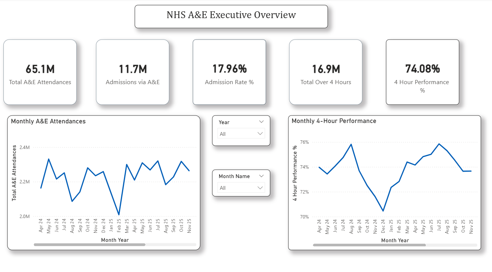
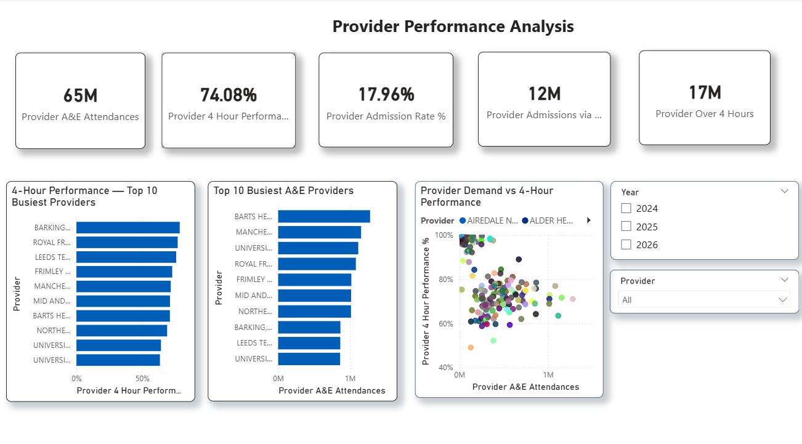
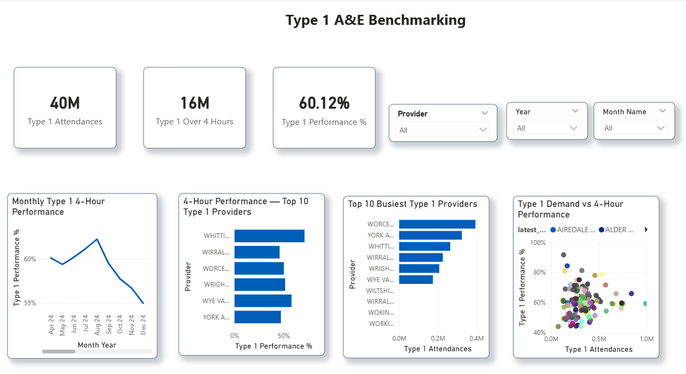
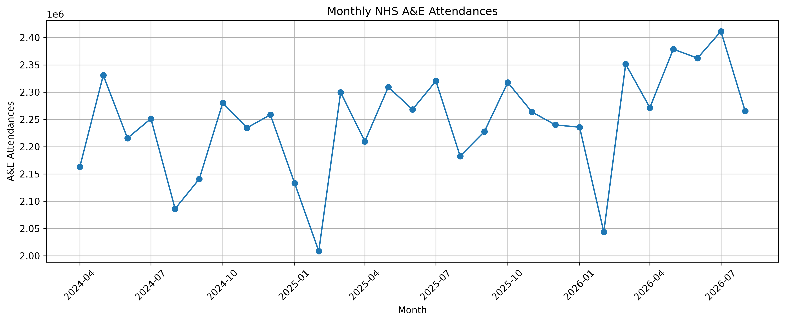
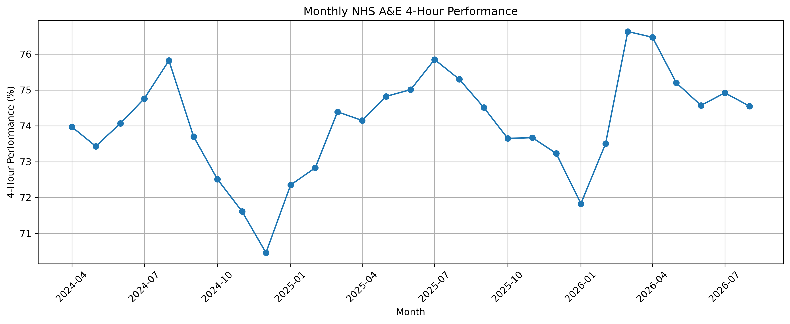
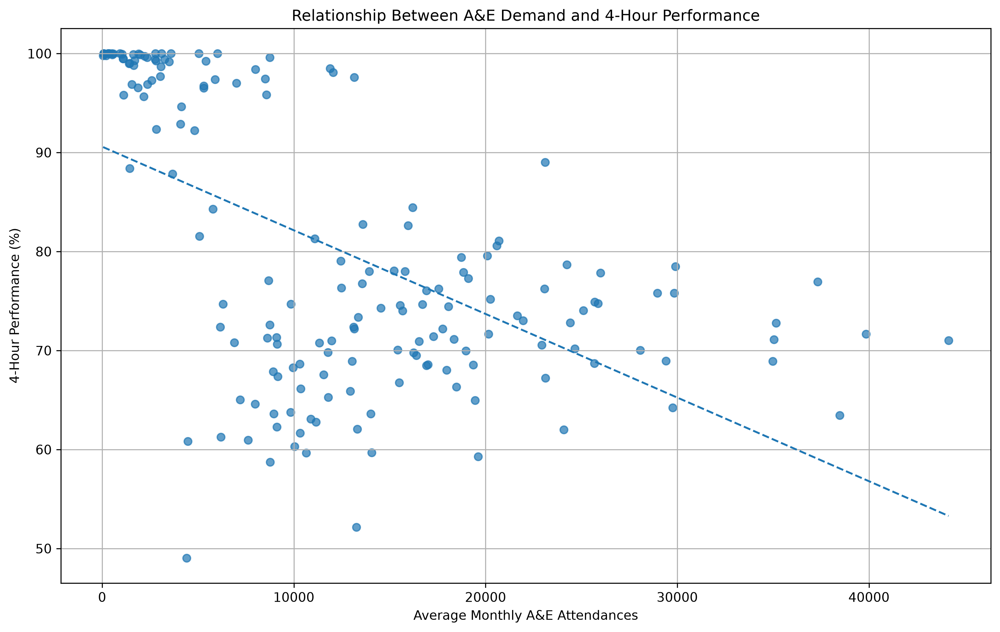
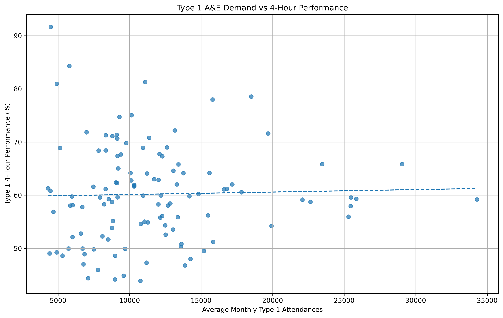

# NHS Hospital Performance Analytics

End-to-end healthcare analytics portfolio project using **Python, PostgreSQL, SQL, Power BI, Docker, Git and GitHub** to analyse NHS A&E performance data and build a reproducible reporting pipeline.

## Measurement scope and review status

**The current processed attendance and over-four-hour columns exclude separately reported booked attendances.** Figures below describe this non-booked population, not the complete published NHS national headline total. The admissions-to-attendance ratio also needs a matched-population definition before being used as an admission probability.

The Power BI Type 1 Top 10 selection requires correction: select providers by **Type 1 Attendances**, rather than an aggregation of provider name. Existing dashboard images retain the earlier selection and should not be used as verified busiest-provider rankings.

Python and SQL correlations currently use different provider-name grouping/cohort rules. Use stable organisation codes and an identical minimum-month cohort before comparing their coefficients. These correlations are descriptive and do not establish what causes performance differences.

These issues are documented openly while the analysis is being improved; the current dashboard is an analytical prototype.

## Recruiter Quick View

This project demonstrates the full workflow I use as a Data Analyst: **source data → cleaning and validation → SQL modelling and analysis → Power BI reporting → business interpretation**.

- **29 monthly NHS files** processed covering April 2024–August 2026
- **5,714 provider-month rows** across **207 organisation codes**
- PostgreSQL analysis using CTEs, window functions, ranking, percentiles and correlation
- **3-page Power BI dashboard** with DAX measures and provider benchmarking
- Cross-validation of key metrics between Python, SQL and Power BI
- Real-world data-quality handling including inconsistent labels, filenames and provider-name changes
- Analytical finding: the apparent demand/performance relationship changed materially after controlling for A&E department type

This is my primary portfolio project for **Data Analyst / BI Analyst / Reporting Analyst** roles.
## Project Overview

This project currently analyses NHS A&E performance from **April 2024 to August 2026**. It covers national demand trends, 4-hour performance, emergency admissions, provider benchmarking, Type 1 major A&E analysis, data-quality validation, SQL analysis and an interactive Power BI dashboard.

The wider capstone will extend the same pipeline to **RTT waiting lists**, **WLMDS demographic/inequality analysis**, forecasting, automated testing, CI/CD and cloud deployment.

## End-to-End Pipeline

```text
NHS raw CSV files
        ↓
Python / Pandas cleaning and validation
        ↓
Processed analytical datasets
        ↓
PostgreSQL in Docker
        ↓
SQL analysis and provider benchmarking
        ↓
Power BI data model + DAX
        ↓
Interactive portfolio dashboard
        ↓
Git / GitHub version control
```

## Current A&E Scope

- Period: **April 2024 to August 2026**
- Monthly files: **29**
- Provider-month rows: **5,714**
- Unique organisation codes observed: **207**
- PostgreSQL analytical tables: **5**
- Power BI report pages: **3**
- Provider identity standardised in SQL using `org_code` and the latest observed organisation name

## Key Findings

### Demand

- A&E attendances increased by **4.72%** between April 2024 and August 2026.
- Highest monthly attendance: **July 2026 — 2,411,415**.
- Lowest monthly attendance: **February 2025 — 2,008,463**.
- Highest average daily demand: **June 2026 — approximately 78,742 attendances/day**.
- Lowest average daily demand: **August 2024 — approximately 67,298 attendances/day**.

### 4-Hour Performance

- April 2024: **73.97%**
- August 2026: **74.55%**
- Change: **+0.58 percentage points**
- Best month: **March 2026 — 76.63%**
- Worst month: **December 2024 — 70.46%**

### Emergency Admissions

- Highest admission rate: **January 2025 — 19.04%**
- Lowest admission rate: **June 2026 — 16.85%**
- Admission rate changed from **18.67% in April 2024** to **17.34% in August 2026**, a fall of **1.33 percentage points**.

### Month-on-Month Movement

- Largest attendance increase: **March 2026 — +15.06%**
- Largest attendance decrease: **February 2026 — -8.59%**
- Largest 4-hour performance improvement: **March 2026 — +3.13 pp**
- Largest deterioration: **September 2024 — -2.12 pp**

## Provider & Type 1 Analysis

An initial all-department provider analysis showed a moderate negative correlation of **-0.568** between demand and 4-hour performance.

After restricting the comparison to **Type 1 major A&E departments**, the relationship largely disappeared. The Python analysis produced a correlation of approximately **0.028**, while the SQL implementation produced approximately **0.038** after provider-name standardisation.

The near-zero Type 1 association contrasts with the all-department association. This is descriptive evidence that department mix and cohort definition matter; it does not identify causal explanations of provider performance.

Examples from the high-volume Type 1 comparison:

- Maidstone and Tunbridge Wells: **78.55%**
- Calderdale and Huddersfield: **78.01%**
- Nottingham University Hospitals: **46.79%**
- University Hospitals of North Midlands: **48.02%**

These comparisons are descriptive and should not be interpreted as causal assessments of provider quality.

## SQL & PostgreSQL

Processed A&E datasets are loaded into PostgreSQL running in Docker.

The SQL analysis includes:

- Data validation and row-count reconciliation
- Provider-name consistency checks
- Canonical provider dimension using `org_code`
- CTEs
- `RANK()`
- `LAG()`
- `PERCENTILE_CONT()`
- `CORR()`
- Weighted performance calculations
- Provider ranking
- High-volume benchmarking
- Meaningful month-on-month change analysis

A reusable SQL script is available at:

```text
sql/04_provider_analysis.sql
```

## Power BI Dashboard

The Power BI report connects directly to PostgreSQL and uses a star-style model with:

- `DateTable`
- `provider_dimension`
- `ae_monthly_summary`
- `ae_provider_month`
- `ae_type1_provider_month`

Key DAX measures include:

- Total A&E Attendances
- Total Over 4 Hours
- 4 Hour Performance %
- Admissions via A&E
- Admission Rate %
- Provider A&E Attendances
- Provider 4 Hour Performance %
- Type 1 Attendances
- Type 1 Performance %

The report contains three pages:

### Executive Overview

National A&E KPIs, monthly demand and 4-hour performance trends, with Year and Month slicers.



### Provider Performance Analysis

Provider-level KPIs, Top 10 busiest providers, performance comparison and demand-vs-performance scatter analysis.



### Type 1 A&E Benchmarking

Type 1 KPIs, high-volume provider comparison, performance benchmarking, scatter analysis and monthly performance trends.



The Power BI file is included in the repository:

[Open the Power BI report file](powerbi/nhs_ae_dashboard.pbix)

## Validation

Power BI measures were checked against the Python and SQL outputs.

Example — **April 2024**:

- Total A&E Attendances: **2,163,149**
- Total Over 4 Hours: **563,068**
- 4 Hour Performance: **73.97%**
- Admissions via A&E: **403,934**
- Admission Rate: **18.67%**

Provider-level and Type 1 measures were also checked for mathematical consistency under Power BI filters.

## Data Quality Work

The project includes real-world data-quality handling such as:

- Inconsistent `TOTAL` row labels across monthly files
- TOTAL rows appearing in different source columns
- Inconsistent filename conventions
- Internal reconciliation of processed totals; external headline reconciliation must use matching booked/non-booked definitions
- Duplicate provider-month checks
- Zero-attendance handling
- Missing-rate validation
- Month-length normalisation
- Provider-name changes over time
- Stable provider analysis using organisation codes

## Technology Stack

### Implemented

- Python
- Pandas
- NumPy
- Matplotlib
- Jupyter Notebook
- PostgreSQL
- SQL
- Power BI
- DAX
- Docker
- Git
- GitHub

### Planned for the Wider Capstone

- Automated testing
- GitHub Actions CI/CD
- Cloud deployment
- Forecasting / machine learning
- RTT waiting-list analytics
- WLMDS demographic and inequality analytics

## Project Structure

```text
nhs-hospital-performance-analytics/
├── data/
│   ├── raw/                         # Ignored by Git
│   └── processed/
├── figures/
│   ├── ae/
│   └── powerbi/
│       ├── executive_overview.png
│       ├── provider_performance.png
│       └── type1_benchmarking.png
├── notebooks/
│   ├── 01_ae_data_understanding.ipynb
│   └── 02_ae_sql_analysis.ipynb
├── powerbi/
│   └── nhs_ae_dashboard.pbix
├── sql/
│   └── 04_provider_analysis.sql
├── docker-compose.yml
├── .env.example
├── .gitignore
└── README.md
```

## Selected Python Visuals

### Monthly A&E Attendances



### 4-Hour Performance



### Demand vs 4-Hour Performance



### Type 1 Demand vs 4-Hour Performance



## Next Phase

The A&E prototype connects preparation, SQL analysis and dashboard reporting. Measurement definitions, consistent provider cohorts and Power BI Top N selection remain under correction before treating it as a validated release.

Next, the wider capstone will continue with:

1. RTT Waiting List Analysis
2. WLMDS Health Inequalities Analysis
3. Integration of A&E + RTT + WLMDS
4. Forecasting / machine learning
5. Automated tests
6. GitHub Actions CI/CD
7. Cloud deployment

## Final Capstone Direction

The final goal is an **NHS Hospital Performance & Waiting List Intelligence Platform** integrating:

- A&E performance
- RTT waiting lists
- WLMDS demographic and inequality data
- PostgreSQL
- Power BI
- Forecasting / machine learning
- Docker
- CI/CD
- Cloud infrastructure

## Disclaimer

This is a portfolio and learning project based on publicly available NHS data. Analytical relationships shown here should not be interpreted as proof of causation. Provider performance may be influenced by factors not included in the current datasets, including patient acuity, staffing, capacity, case mix and service configuration.


## Reproduce stable-code cohort checks

From the repository root, run:

```bash
python scripts/validate_provider_cohorts.py --min-months 24
```

Python 3.9+ standard library only. The script validates unique provider-month keys and count bounds, groups by organisation code, requires at least 24 positive-attendance months, calculates weighted performance, correlates mean monthly attendance with performance and returns the ten busiest eligible providers by total attendance. Different departments can have different eligible cohorts; these are not paired-provider estimates.

With the currently committed processed CSVs: 180 eligible all-department providers (correlation approximately -0.574) and 121 Type 1 providers (approximately 0.038). The Type 1 highest-volume eligible provider is University Hospitals Birmingham (RRK), 994,229 attendances. This executable check does not repair the existing PBIX visuals or reconcile booked attendances to official national totals.
