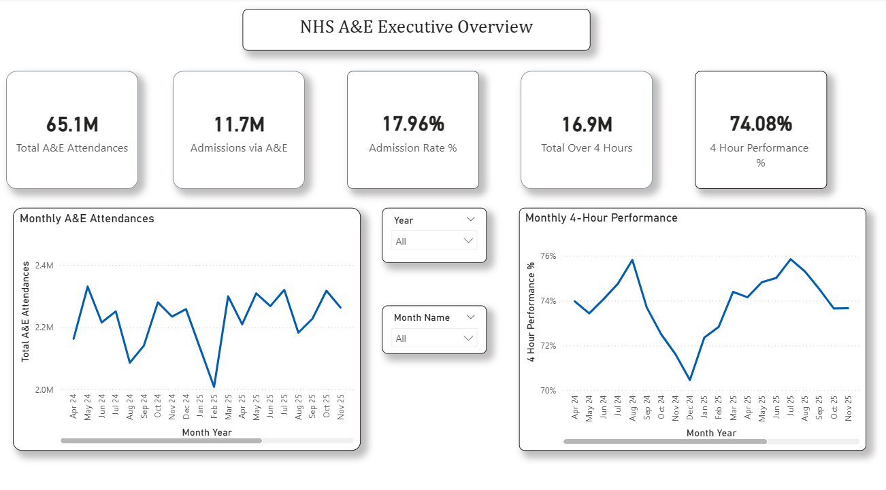
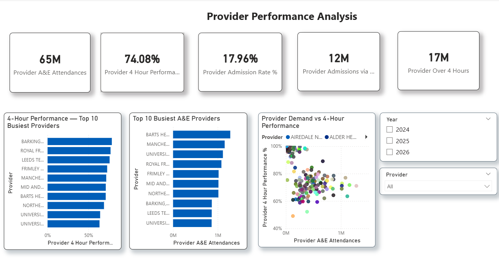
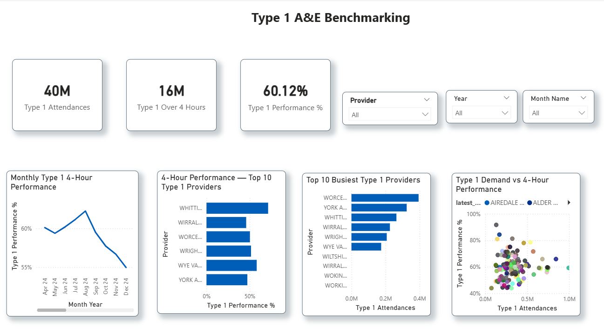

# NHS Hospital Performance Analytics

An independent reporting prototype using NHS England’s monthly A&E Attendances and Emergency Admissions data. It explores how demand and four-hour performance vary across months and providers, and how the choice of providers affects that comparison.

The [processed data](data/processed) span April 2024 to August 2026: 29 months, 5,714 provider-month records in each departmental extract and 207 organisation codes before eligibility checks. The attendance and over-four-hour counts exclude separately reported booked attendances. The [source reconciliation and validation record](docs/phase-4-validation.md) compares all 29 official releases with the committed inputs and explains differences in five revised months.

## How to inspect the project

| Deliverable | What the repository demonstrates |
|---|---|
| [Python preparation notebook](notebooks/01_ae_data_understanding.ipynb) | Reads monthly files, handles variations in total-row labels, prepares counts and exports data and charts. Provider summaries use stable codes and positive-attendance months. |
| [Python cohort validator](scripts/validate_provider_cohorts.py) | Checks unique organisation-code/month keys and valid attendance and breach counts. Calculates weighted provider performance, correlations and attendance rankings on the committed CSVs. |
| [PostgreSQL queries](sql/04_provider_analysis.sql) and [SQL notebook](notebooks/02_ae_sql_analysis.ipynb) | Inspect the provider aggregation, attendance ranking and Type 1 correlation query. [Docker Compose](docker-compose.yml) supplies local database configuration. All checked-in SQL files were executed on disposable PostgreSQL 16.2. Power BI refresh remains outstanding. |
| [Power BI report](powerbi/nhs_ae_dashboard.pbix) | Three saved pages cover the executive overview, provider performance and Type 1 benchmarking. The previews below are historical exports. Two Type 1 chart filters require repair. |

## What the provider comparison shows

The unit of comparison is a **provider**, identified by organisation code so a change in display name does not split its records. For each eligible provider, demand is mean monthly attendance over qualifying months. Four-hour performance is weighted by attendance: **100 × (sum of attendances − sum over four hours) / sum of attendances**. Pearson’s *r* compares those two provider-level measures.

| Eligibility rule | All departments | Type 1 major A&E |
|---|---:|---:|
| At least 24 positive-attendance months in each extract independently | 180 providers, *r* = −0.574 | 121 providers, *r* = +0.038 |
| Same providers and months in both extracts | 121 providers, *r* = +0.159 | 121 providers, *r* = +0.038 |

For the matched check, join the extracts on organisation code and month, retain rows with positive attendance in both, then keep providers with at least 24 such months. Recalculate both measures on the same **3,507 provider-months**. Changing the comparison population changes even the sign of the all-department coefficient. The original difference therefore cannot be attributed solely to restricting activity to Type 1.

These are descriptive results from processed portfolio data. Matching addresses one comparability issue. It does not resolve booked attendance coverage, organisational reorganisations, case mix or other differences between services, establish causation or constitute an official NHS conclusion.

**Reproduce the independent and matched cohorts** from the repository root with Python 3.9 or later (standard library):

```bash
python scripts/validate_provider_cohorts.py --min-months 24
```

The validator reports separate results for each independently eligible extract and each matched series. For the full-period eligible Type 1 cohort the validator ranks RRK first with 994,229 attendances. That result applies to this eligibility rule and period; a dashboard slicer can change the applicable reference ranking.

## Reading the measures

- **Attendance and four-hour performance.** In the processed April 2024 counts, 563,068 of 2,163,149 attendances exceeded four hours. The weighted within-four-hours figure is 73.97%. This cross-check uses the non-booked columns.
- **Admissions.** The numerator sums emergency admissions via Type 1, Type 2 and other A&E departments, excluding the separate “other emergency admissions” category. The denominator sums the non-booked attendance columns across those departments. For April 2024 the historical ratio is 403,934 / 2,163,149 = 18.67%. The extracts do not establish that numerator and denominator cover the same encounters. Labels such as “Admission Rate %” describe this aggregate ratio only; they cannot estimate a patient's probability of admission.

## Power BI previews

**Executive overview.** Historical dashboard view. Attendance and four-hour KPIs use the non-booked scope above. Interpret the admissions percentage only as an unmatched aggregate ratio.



**Provider performance.** Historical all-department view. The saved all-department Top N filters use provider attendance. Independent validation of the displayed ordering, slicers and DAX after refresh is outstanding. Use the cohort table above for correlations.



**Type 1 benchmarking — provisional ranking.** In the saved report, both *Top 10 Busiest Type 1 Providers* and *4-Hour Performance — Top 10 Type 1 Providers* select their ten providers using an aggregation of provider name. Neither chart establishes the ten busiest providers by Type 1 attendance. Both need their selection measure corrected and their membership checked under the active filters before a new preview is exported.



## Python figures and historical outputs

The original images are retained for inspection. The two saved scatterplots use the earlier notebook grouping, which includes provider name alongside code. Their historical results (about −0.568 and +0.028) are superseded for stable-code comparisons by the table above.

| Figure | Interpretation |
|---|---|
| [Monthly attendances](figures/ae/monthly_ae_attendances.png) · [Average daily attendances](figures/ae/average_daily_ae_attendances.png) · [Month-on-month attendance change](figures/ae/ae_month_on_month_attendance_change.png) | Non-booked activity. The daily series adjusts for the number of days in a month. |
| [Four-hour performance](figures/ae/four_hour_performance.png) | Monthly performance for the processed attendance population. |
| [Admissions ratio](figures/ae/ae_admission_rate.png) | Historical “admission rate” label. Numerator and denominator have unmatched encounter coverage. |
| [Busiest A&E organisations](figures/ae/top_10_busiest_ae_organisations.png) | Historical all-department notebook ranking from the earlier code-and-name summary; inspect the corrected summaries for stable-code results. |
| [All-department scatterplot](figures/ae/ae_demand_vs_4hour_performance.png) | Historical provider grouping and independently eligible population; do not read as the matched result. |
| [Type 1 scatterplot](figures/ae/type1_demand_vs_4hour_performance.png) | Historical Type 1 grouping; comparison with the all-department plot does not isolate department type. |

## Outstanding validation and future work

1. Correct both Power BI Type 1 Top N filters to use Type 1 attendances. Check membership, ties, weighted KPIs and slicer behaviour against independent aggregates, then refresh and export new previews.
2. Compare DAX and chart membership with the [validated full-period and April 2024 SQL references](docs/phase-4-validation.md). Verify report relationships and slicers in Power BI before publishing new previews.
3. Select and label a source vintage before any dashboard refresh. Preserve the distinction between the non-booked attendance population and admissions via A&E.

Python regression tests and a local PostgreSQL integration check are available in [tests](tests). GitHub Actions CI/CD, cloud deployment, forecasting, RTT waiting-list analysis and WLMDS inequalities analysis are future work.
