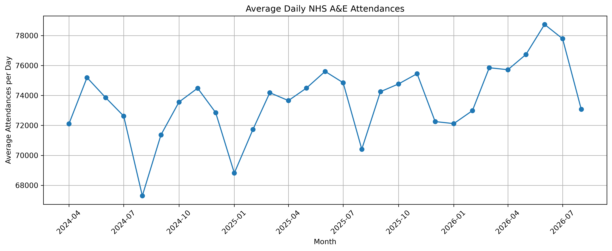
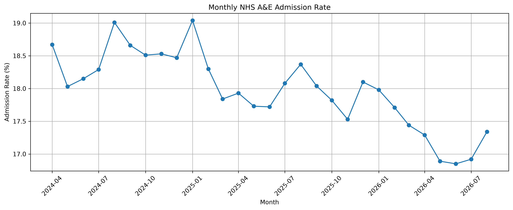

# NHS Hospital Performance Analytics

End-to-end NHS hospital performance analytics project using Python, SQL, Power BI, Docker, CI/CD and Cloud.

## Project Overview

This project analyses NHS A&E performance data from April 2024 to August 2026. The current phase focuses on demand, 4-hour performance, emergency admissions, provider-level variation, and data quality. The wider capstone will later extend into RTT waiting-list analysis, WLMDS demographic analysis, PostgreSQL, Power BI, CI/CD and cloud deployment.

## Objectives

- Analyse monthly A&E demand trends.
- Measure 4-hour performance over time.
- Analyse emergency admissions through A&E.
- Compare provider-level performance.
- Investigate whether higher demand is associated with lower 4-hour performance.
- Build reusable, validated datasets for SQL and dashboarding.
- Develop the project into an end-to-end analytics pipeline with Docker, CI/CD and cloud deployment.

## Current A&E Scope

- Period: April 2024 to August 2026
- Monthly files: 29
- Provider-month rows: 5,714
- Unique organisation codes: 207
- Type 1 providers included in comparative analysis: 115

## Key Findings

### Demand

- A&E attendances increased by 4.72% between April 2024 and August 2026.
- Highest monthly attendance: July 2026 — 2,411,415.
- Lowest monthly attendance: February 2025 — 2,008,463.
- After adjusting for month length, the highest average daily demand occurred in June 2026 at approximately 78,742 attendances per day.
- The lowest average daily demand occurred in August 2024 at approximately 67,298 attendances per day.

### 4-Hour Performance

- April 2024 performance: 73.97%.
- August 2026 performance: 74.55%.
- Overall change: +0.58 percentage points.
- Best month: March 2026 — 76.63%.
- Worst month: December 2024 — 70.46%.

### Emergency Admissions

- Highest admission rate: January 2025 — 19.04%.
- Lowest admission rate: June 2026 — 16.85%.
- Admission rate fell from 18.67% in April 2024 to 17.34% in August 2026, a decrease of 1.33 percentage points.

### Month-on-Month Movement

- Largest attendance increase: March 2026 — +15.06%.
- Largest attendance decrease: February 2026 — -8.59%.
- Largest 4-hour performance improvement: March 2026 — +3.13 percentage points.
- Largest 4-hour performance deterioration: September 2024 — -2.12 percentage points.

### Provider Analysis

Initial analysis across all A&E department types showed a moderate negative correlation of -0.568 between attendance volume and 4-hour performance. However, when the comparison was restricted to Type 1 major A&E departments, the correlation fell to 0.028.

This suggests that the original relationship was influenced by differences in department type and service configuration rather than patient volume alone. Among high-volume Type 1 providers, performance varied substantially, indicating that demand alone does not explain performance differences.

## Data Quality Work

The project includes several real-world data quality checks and fixes:

- Inconsistent TOTAL row labels across monthly files.
- TOTAL rows appearing in different columns.
- Inconsistent file naming conventions, including `Nov-25` instead of a full month-year name.
- Validation of national totals against NHS source totals.
- Duplicate provider-month checks.
- Missing-rate validation for zero-attendance provider rows.
- Daily normalisation to account for different month lengths.

## Technology Stack

### Current

- Python
- Pandas
- NumPy
- Matplotlib
- Jupyter Notebook
- Docker
- Git
- GitHub

### Planned

- PostgreSQL
- SQL
- Power BI
- Automated testing
- GitHub Actions CI/CD
- Cloud deployment
- Forecasting / machine learning in the final capstone

## Project Structure

```text
nhs-hospital-performance-analytics/
├── data/
│   ├── raw/                  # Ignored by Git
│   └── processed/
│       ├── ae_monthly_summary.csv
│       ├── ae_provider_month.csv
│       ├── ae_provider_summary.csv
│       ├── ae_type1_provider_month.csv
│       └── ae_type1_provider_summary.csv
├── figures/
│   └── ae/
├── notebooks/
│   └── 01_ae_data_understanding.ipynb
├── sql/                      # Planned
├── src/                      # Planned
├── tests/                    # Planned
├── .gitignore
└── README.md
```

## Selected Visuals

### Monthly A&E Attendances


### Average Daily A&E Attendances



### 4-Hour Performance


### A&E Admission Rate



### Demand vs 4-Hour Performance


### Type 1 Demand vs 4-Hour Performance


## Next Phase

The next phase will move the processed A&E datasets into PostgreSQL and answer business questions using SQL. Planned SQL work includes:

- Monthly trend analysis.
- Provider ranking.
- Best and worst performing organisations.
- CTEs and window functions.
- Month-on-month comparisons.
- Provider benchmarking.

After SQL, the project will move into Power BI dashboard development, followed by automated testing, GitHub Actions CI/CD, Dockerised services and cloud deployment.

## Final Capstone Direction

The wider project will evolve into an NHS Hospital Performance & Waiting List Intelligence Platform by integrating:

- A&E performance data.
- RTT waiting-list data.
- WLMDS demographic and inequality data.
- PostgreSQL.
- Power BI.
- Forecasting / machine learning.
- Docker.
- CI/CD.
- Cloud infrastructure.

## Disclaimer

This is a portfolio and learning project based on publicly available NHS data. Analytical relationships shown here should not be interpreted as proof of causation. Provider performance may be influenced by factors not included in the current datasets, including patient acuity, staffing, capacity, case mix and service configuration.
